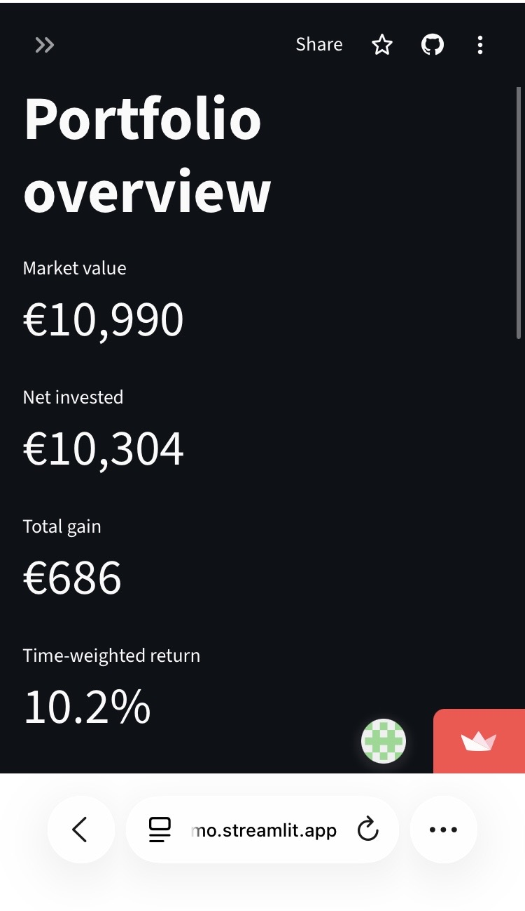
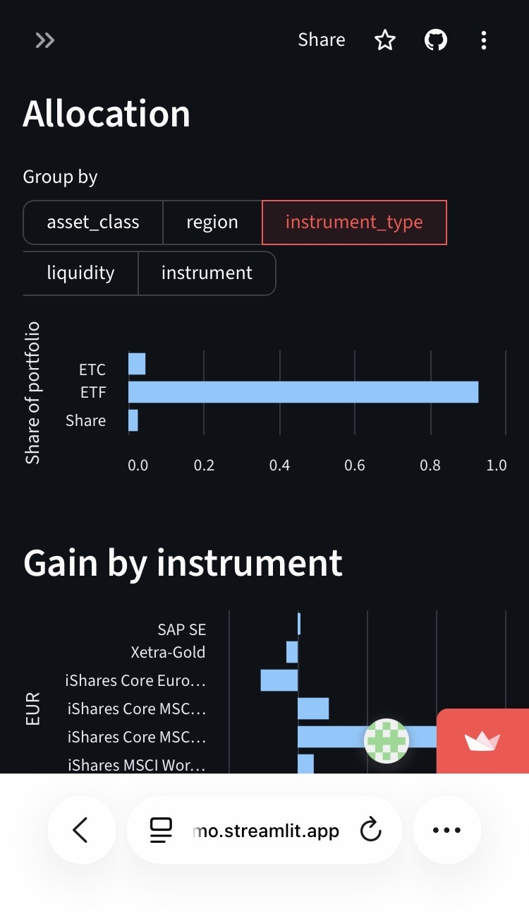
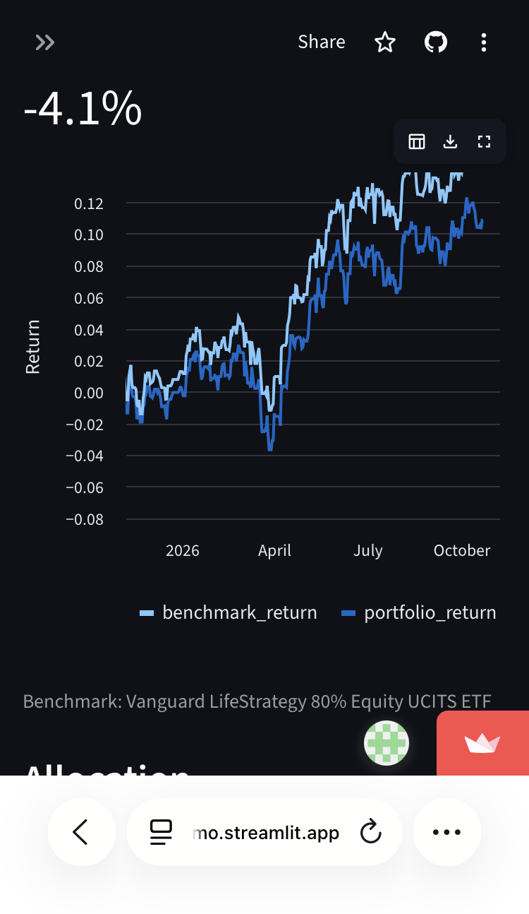
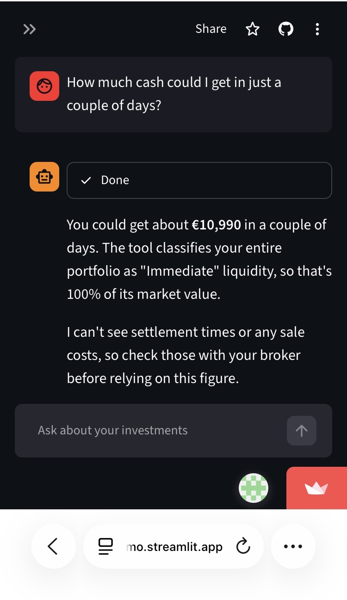
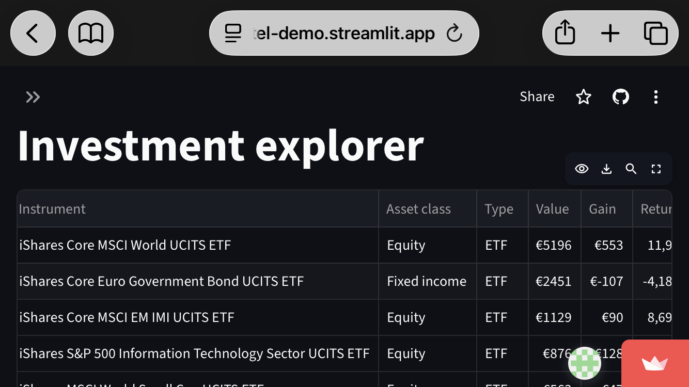

# Personal Investment Intelligence

[](https://github.com/ej-macias/personal-investment-intelligence/actions/workflows/ci.yml)


[](https://ej-macias.github.io/personal-investment-intelligence/)


A personal investment analytics app. It consolidates investments held at Indexa Capital and
elsewhere, models portfolio performance with dbt, and answers questions in plain language
through an AI assistant that works from a fixed set of analytical tools.

The public demo runs on a fictional portfolio valued at real market prices. The real portfolio lives in a separate, private
database behind a login.

**Live demo: [invest-intel-demo.streamlit.app](https://invest-intel-demo.streamlit.app)**,
best viewed on a phone. The dashboards are open to everyone; the AI assistant is available on
request with an access code, to keep API costs under control.

<p>
  
  
  
  
</p>
<p>
  
</p>

## Architecture

```
 Indexa Capital ─┐
 Airtable ───────┼─▶ Python ingestion ─▶ raw (bronze) ─▶ dbt ─▶ silver ─▶ gold ─▶ Streamlit
 EODHD prices ───┘   GitHub Actions       JSONB,          staging,          marts    ├─ dashboards
                     daily                append-only     typed, tested              └─ AI assistant
                                                                                        (tool calling)
 Fictional portfolio + real EODHD prices ─▶ raw (demo database only)
```

| Layer | Technology | Where |
|---|---|---|
| Ingestion | Python, httpx, psycopg | [src/invest_intel/ingestion/](src/invest_intel/ingestion/) |
| Storage | PostgreSQL (Neon) | schemas `raw`, `silver`, `gold` |
| Transformation and data quality | dbt Core | [dbt/](dbt/) |
| Metric definitions | dbt semantic layer (MetricFlow) | [docs/semantic-layer.md](docs/semantic-layer.md) |
| Query layer | Fixed, parameterised SQL over `gold` | [src/invest_intel/analytics/queries.py](src/invest_intel/analytics/queries.py) |
| AI assistant | Claude with tool calling | [src/invest_intel/assistant/](src/invest_intel/assistant/) |
| Front end | Streamlit, Auth0 login | [app/](app/) |
| Scheduling and CI | GitHub Actions | [.github/workflows/](.github/workflows/) |
| Demo data | Fictional portfolio at real EODHD prices | [src/invest_intel/synthetic/generate.py](src/invest_intel/synthetic/generate.py) |

Why I built it and the decisions behind it are in the [case study](docs/case-study.md). The
design decisions, the table catalogue and the security model are in
[docs/architecture.md](docs/architecture.md).

## Data model

- **Bronze (`raw`)**: one append-only table per API endpoint, each storing the source payload
  as JSONB. A record is stored again only when its content changes.
- **Silver**: `stg_*` views that type and deduplicate each source, plus `int_prices_daily`,
  one price per instrument per calendar day.
- **Gold**: `dim_instrument`, `fct_transactions`, `fct_positions_daily`, and the analytical
  tables `portfolio_performance`, `investment_returns`, `asset_allocation`,
  `benchmark_comparison`, `portfolio_monthly`, `portfolio_highlights`, and the owner's plan
  checked against today in `investment_plan` and `target_checks`.

Every model, column and test, with the lineage graph from source to dashboard, is browsable in
the **[dbt docs site](https://ej-macias.github.io/personal-investment-intelligence/)**. It is
rebuilt on every change to `main` from synthetic data, never from a real database.

## The AI assistant

The model has no database access and never writes SQL. It chooses among eight tools
(`get_portfolio_summary`, `get_portfolio_performance`, `get_asset_allocation`,
`get_investment_returns`, `compare_with_benchmark`, `get_investment_plan`,
`get_monthly_summary`, `get_transactions`), each backed by the
same fixed queries the dashboards use, through a database role that can only read `gold`.
In the private app, conversations are saved per user and can be reopened later; reopening one
reads it from the database without calling the API.

## Run the demo locally

Requires Python 3.11+ and a PostgreSQL database (Docker, or a free Neon project).

```bash
cp .env.example .env          # set APP_ENV=demo and the PG* variables
make setup && source .venv/bin/activate
make db-up                    # local PostgreSQL via Docker; skip when using Neon
make demo-data                # synthetic instruments, prices and transactions into raw
make dbt-build                # build and test silver and gold
make app                      # http://localhost:8501
```

The assistant page also needs `ANTHROPIC_API_KEY`. `make test` and `make lint` run the unit
tests and the linter.

## Environments

| | Data | Database | App access |
|---|---|---|---|
| `demo` | Fictional portfolio at real EODHD prices; Indexa and Airtable are never called | Its own Neon project | Open |
| `prod` | Real accounts, via the daily pipeline | Private Neon project | Auth0 login, email allowlist |
| `dev` | Either | Local PostgreSQL | Auth0 login, or use `demo` |

The two deployments share code and nothing else: different databases, different credentials,
different GitHub environments.

## Status

Both deployments run end to end. The public demo refreshes weekly at real prices; the private
app, on real accounts, refreshes daily behind a login and keeps the assistant's conversations.
Still to do:

- [x] Indexa payload fields confirmed against a live account
- [x] Demo: Neon project, GitHub environment and Streamlit deployment
- [x] Private: Airtable base ([fields](docs/architecture.md#airtable-base)), Neon project, GitHub environment and Streamlit deployment
- [ ] Model cash transactions (deposits, withdrawals, fees) from Indexa
- [ ] Multi-currency support (everything is assumed to be EUR)
- [ ] Evaluation set for the assistant's answers
